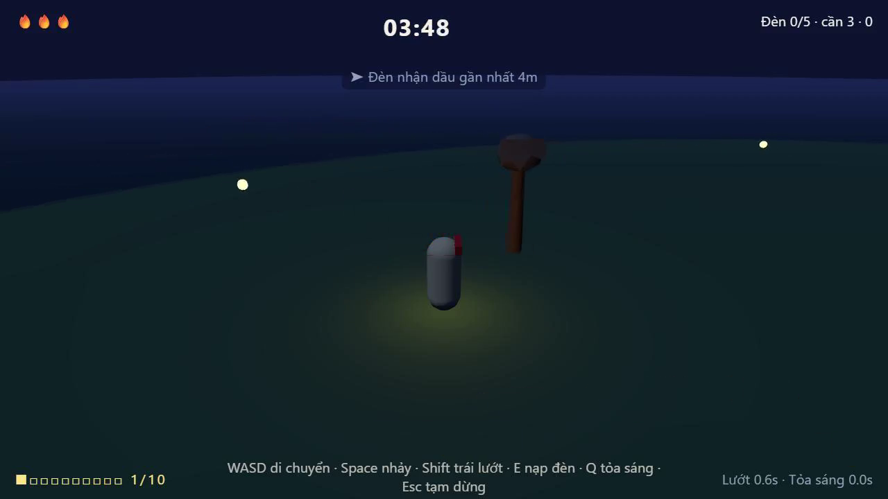

# Đảo Đèn Lồng

> Game 3D góc nhìn thứ ba — Day 12 AI SDLC lab. Release **v1.0.0** · Test Contract **v1.3**.
> **Video demo (~48 s):** [docs/demo/demo.mp4](docs/demo/demo.mp4)
>
> 

Bạn là **Mây**, người giữ đèn nhỏ tuổi. Ba đêm, ba hòn đảo — gom đom đóm, thắp và **châm dầu** các Đèn Lồng Lớn để giữ đảo sáng tới bình minh, né Bóng Mực hút dầu, Gió Lạc và những cơn gió lạc trên đảo.

## Yêu cầu hệ thống

- Node.js **20+** và npm (đã thử với Node 26 / npm 11).
- Trình duyệt có WebGL 2 (Chrome, Edge, Firefox) để chơi; Chrome/Edge để chạy `npm run bench` và `npm run demo`.
- ~2 GB RAM trống; GPU rời không bắt buộc (đã đo được 60 FPS bằng GPU tích hợp).
- macOS / Linux / Windows — không dùng API đặc thù hệ điều hành.

## Cài đặt & chạy (tối đa 3 lệnh)

```bash
npm ci
npm run dev        # mở http://localhost:5173
```

Chỉ 2 lệnh. Muốn chạy bản phát hành tĩnh:

```bash
npm ci && npm run build && npx vite preview --outDir dist/web
```

`npm run build` tạo `dist/web/` (web tĩnh, kèm theo Release), `dist/headless.mjs` (runner JSONL) và `dist/sim.mjs` (logic cho bench/soak/export). Script `run_cmd` theo contract là `node scripts/run.mjs` (khởi động dev server, hoặc `--export-leaderboard out.json`).

## Điều khiển

| Phím | Tác dụng |
|---|---|
| `W A S D` / phím mũi tên | Di chuyển theo hướng camera |
| Kéo chuột | Xoay camera (độ nhạy trong Cài đặt) |
| `Space` | Nhảy (7 m/s, chỉ khi chạm đất) |
| `Shift` | Lướt 14 m/s trong 0.2 s, hồi chiêu 1.5 s |
| `E` | Nạp đom đóm vào đèn gần nhất: thắp (10), thắp lại (5), hoặc châm dầu đèn đang sáng |
| `Q` | Tỏa Sáng: tốn 3 đom đóm, choáng Bóng Mực, hồi chiêu 3 s |
| `Esc` / `P` | Tạm dừng (Tiếp tục / Chơi lại / Cài đặt / Về menu) |

Mọi phím ở trên đều đổi được trong **Cài đặt → Đổi phím** (phát hiện trùng phím, có nút «Khôi phục mặc định»). Cùng trang này có «Bảng màu dễ phân biệt», «Giảm chuyển động», «Chữ lớn (×1.25)» — tất cả lưu lại sau khi tắt game.

## Luật chơi — Test Contract v1.3 (giữ nguyên luật v1.2 «Đèn cạn dầu»)

- **Số liệu chuẩn:** 60 tick/giây; chạy 6 m/s (tăng tốc ≤ 0.1 s); nhảy 7 m/s với trọng lực −20 m/s²; lướt 14 m/s / 0.2 s / 1.5 s.
- **Đom đóm:** tự nhặt khi XZ ≤ 1 m và chênh cao ≤ 1.5 m; sức chứa `10 + 2 × successful_lights` (tối đa 20); bắt đầu 20 con tại 20 điểm, trần 30, cứ 240 tick thêm 1 con ở điểm trống.
- **Đèn:** thắp lần đầu 10 đom đóm, thắp lại 5; khi thắp `fuel = 100`. Hao 1 dầu/giây. Châm dầu dùng `ceil((100 − fuel)/10)` đom đóm (mỗi con +10 dầu). `fuel < 30` thì mất vùng an toàn (đúng 30 vẫn còn); `fuel ≤ 0` → tắt, `lantern_out`, nhớ `ever_lit`. Chọn đèn nhận được gần nhất, bằng nhau chọn id nhỏ hơn.
- **Bóng Mực:** 4 m/s (Đêm 3 là 4.5), phát hiện 12 m / bỏ đuổi 18 m; khi `wander` đi tới đèn yếu (hoặc đèn tắt) gần nhất, cách ≤ 2 m thì sang `drain` và hút 5 dầu/giây (cộng dồn). Từ `drain`: sang `chase` nếu Mây vào 6 m, `stunned` nếu trúng Tỏa Sáng, `wander` nếu đèn tắt/được châm lên ≥ 30/cách > 2 m. Chạm → mất 1 Ngọn Lửa, rơi `floor(carried/2)` đom đóm, bất tử 90 tick; hết choáng về `wander`.
- **Gió Lạc (Đêm 2, 3):** bay 7 m/s, cướp tối đa 3 đom đóm rồi bay ra xa; Tỏa Sáng làm nó thả đồ lại (`drifter_drop`).
- **Bùa Gió:** hiệu lực 600 tick — chạy 7.2 m/s và lướt không hồi chiêu (vẫn phải nhấn lại); mọc lại sau 2700 tick.
- **Rơi khỏi đảo (Y < −10):** mất 1 lửa + toàn bộ đom đóm, chờ 60 tick rồi hồi sinh bất tử 90 tick. `fall_enabled: true`.
- **Thời gian & thắng:** Đêm 1/2/3 = 240/270/300 s. **Không thắng sớm.** Hết giờ và còn ≥ `ceil(0.6 × tổng đèn)` đèn sáng → thắng (`dawn_survived`); thiếu → thua (`dawn`); hết lửa → thua ngay (`no_flames`), kể cả tick cuối.
- **Điểm (mới):** +5 mỗi đom đóm nạp (thắp/thắp lại/châm dầu), +100 thắp lần đầu, +40 thắp lại, +5 mỗi Bóng Mực choáng (tổng +15 nếu đang drain), bình minh + mỗi đèn sáng `50 + floor(fuel)` và +50 mỗi Ngọn Lửa. Bỏ thưởng thời gian. Tổng điểm là tổng các Đêm đã thắng.
- **Mù màu:** Cài đặt → «Bảng màu dễ phân biệt» (lưu lại): viền/mắt Bóng Mực xanh dương `#00B3FF`, cảnh báo UI trắng kèm ⚠; đèn tắt xẹp 20% + giấy rách, đèn yếu nhấp nháy 1 Hz.

### Ba đêm

| Đêm | Tên | Bản đồ | Cơ chế riêng |
|---|---|---|---|
| 1 | Đảo Bến | Đảo tròn bán kính 40 m, 5 đèn | Làm quen, Bóng Mực sinh mỗi 8 s |
| 2 | Đảo Cau | 2 đảo bán kính 28 m nối cầu, bục nhảy, 6 đèn | Gió Lạc, Bùa Gió, Bóng Mực mỗi 7 s |
| 3 | Đảo Chuông | 3 tầng Y=0/3/6, dốc, tháp chuông, 7 đèn | Gió 5 s sau mỗi 30 s (báo trước 2 s), Bóng Mực mỗi 6 s |

## Kiểm thử & chế độ headless

```bash
npm test                    # unit test (43 tests)
npm run typecheck           # tsc --noEmit
npm run verify -- phase-4   # test + typecheck + build + tất định + exit code + bench/soak/export, ghi docs/proof/phase-4/
npm run fps -- phase-4      # đo FPS GUI thật ở 1280×720 (cần Chrome/Edge)
```

`verify` tự chạy mọi thứ ở trên; bằng chứng các phase trước vẫn nằm trong `docs/proof/phase-{0,1,2,3}/`. Chạy headless theo Test Contract v1.3 (luật gameplay vẫn là v1.2, 60 tick/giây, không cần GPU):

```bash
npm run build:headless
node dist/headless.mjs --seed 7 --night 1 \
  --scenario tests/fixtures/scenario-features.json \
  --inputs tests/fixtures/inputs-features.json \
  --ticks 600 --snapshot-every 10 --out .tmp/run.jsonl
```

- `--night` nhận `1`, `2`, `3` (ngoài khoảng → exit 1).
- `--scenario`, `--inputs` là tùy chọn; không có thì dùng mặc định của game.
- Mã thoát: `0` thành công, `1` lỗi tham số/file không tồn tại, `2` file sai định dạng.
- Cùng `--seed` + night + scenario + inputs cho output **giống hệt** (sha256 trong `npm run verify`).
- Fixture theo từng tính năng mới nằm ở `tests/fixtures/` (`scenario-fuel`, `scenario-refuel`, `scenario-drain`, `scenario-relight`, `scenario-dawn-win`, `scenario-dawn-lose`, `scenario-capacity`, …).
- Bằng chứng Phase 4: `docs/proof/phase-4/` (mọi check của v1.0–v1.2 + bench/soak/export/đóng gói). Phase 3: `docs/proof/phase-3/` (50 check, regression Phase 1–2 bằng số chuẩn, FPS 60 @ 1280×720).

Các con số gameplay (`tuning`) nằm trong [`game.contract.json`](game.contract.json) và phải khớp `src/sim/config.ts` — có test tự động chặn nếu lệch. Hợp đồng v1.3 bổ sung `bench_cmd`, `soak_cmd`, đổi `run_cmd` thành `node scripts/run.mjs`; **không đổi một con số gameplay hay một dòng JSONL nào**.

## Benchmark, soak, bảng xếp hạng

```bash
npm run bench -- --seed 42 --duration 30 --out bench.json
npm run soak -- --seed 7 --nights 10 --out soak.json
npm run start -- --export-leaderboard out.json     # xem lại bảng dưới dạng JSON
```

**Benchmark** dùng Chrome/Edge + CDP ở đúng 1280×720 với `--disable-frame-rate-limit --disable-gpu-vsync`. Cảnh chuẩn: Đêm 1, 200 Bóng Mực `wander`, 100 đom đóm, 3 đèn sáng, camera quay tròn bán kính 30 m / cao 15 m / 15 s một vòng, 3 s khởi động không đo. Bóng không gây sát thương, không sinh thêm thực thể, đèn không hao dầu, không có điều kiện thắng/thua. Ngưỡng tham khảo: `avg_fps ≥ 60`, `p1_low_fps ≥ 30`, `load_ms ≤ 10000`.

- `peak_mem_mb = null`: bản đo là web (Chrome điều khiển qua CDP), CDP chỉ phơi bày heap JavaScript chứ không phải RSS của tiến trình trình duyệt, nên ghi `null` thay vì một con số giả. Dùng `soak.json` cho số đo RSS tiến trình thật.
- `vsync_off: true` thể hiện cờ khởi động; nếu trình điều khiển GPU của hệ điều hành vẫn ép vsync thì số FPS sẽ bị khóa — máy chấm sẽ tự đo lại.

**Soak** chạy 10 Đêm liên tiếp trong cùng process Node, seed `7 + i`, input ngẫu nhiên theo luật ticket. Đạt khi `crashes = 0` và `mem_end_mb ≤ 1.2 × mem_start_mb`. Kết quả tự chạy của tôi nằm ở `bench.json` và `soak.json` (cũng được copy vào `docs/proof/phase-4/`).

**Bảng xếp hạng** lưu tại `data/leaderboard.json` (tối đa 10 mục, bằng điểm thì người đến trước đứng trên). GUI gọi API `/api/leaderboard` của dev server; bản web tĩnh không có server thì tự fallback sang `localStorage`. Lệnh export ở trên đọc đúng cùng một file.

## Khả năng tiếp cận

| Tính năng | Cách dùng |
|---|---|
| Đổi phím | Cài đặt → bảng «Đổi phím» cho 9 hành động; báo lỗi khi trùng, có nút khôi phục mặc định |
| Phụ đề & mũi tên | Khi Bóng Mực xuất hiện (mũi tên ở mép màn hình), gió sắp thổi, 10 s cuối, đèn `fuel < 30` |
| Giảm chuyển động | Cài đặt → «Giảm chuyển động»: tắt rung camera, chớp đỏ khi bị thương và hiệu ứng nhấp nháy |
| Cỡ chữ | Mặc định 18 px @ 1280×720; tùy chọn «Chữ lớn» nhân 1.25 |

## Cấu trúc

```text
src/sim/       logic thuần: world, step, geometry, input, scenario, output (không DOM)
src/main.ts    GUI Three.js (chỉ đọc World và vẽ) + accessibility + leaderboard hooks
src/leaderboard.ts  luật bảng xếp hạng thuần (dùng chung GUI và Node)
src/headless/  runner JSONL theo Test Contract
tests/         unit test + fixture scenario/inputs
scripts/       verify.mjs, fps.mjs, bench.mjs, soak.mjs, run.mjs, leaderboard.mjs, demo.mjs
data/          leaderboard.json — bảng xếp hạng lưu trên đĩa
docs/demo/     demo.mp4 + screenshot.png
docs/notes/    giả định, quyết định, nhật ký AI, retro, ADR
docs/proof/    bằng chứng từng phase
docs/requirements/  ticket gốc + spec acceptance criteria
```

`.tmp/` (benchmark profiles, ffmpeg tạm, ảnh demo) và `log.md` (nhật ký thao tác local) đều nằm trong `.gitignore`, không bao giờ được commit.

## Sáng tạo của tôi

- **Bóng Mực xuất hiện theo sóng:** mỗi đêm một nhịp sinh riêng (8 s / 7 s / 6 s), tạo áp lực tăng dần mà không cần asset mới.
- **Đèn là khu an toàn có hạn:** Bóng Mực bị chặn ở rìa `safe_radius` chỉ khi đèn còn ≥ 30 dầu; đèn yếu trở thành miếng mồi, ép người chơi vừa châm dầu vừa dọn bóng.
- **Pulse hy sinh tài nguyên:** xua bóng tiêu 3 đom đóm, ép người chơi cân bằng giữa nạp đèn và tự vệ.
- **Gió Lạc cướp đồ:** dải lụa bay nhanh cướp đom đóm rồi tháo chạy — bị Tỏa Sáng thì thả lại tại chỗ.
- Toàn bộ hình khối tự sinh bằng Three.js, không dùng asset ngoài (xem `CREDITS.md`).

## Tài liệu lab

| File | Nội dung |
|---|---|
| [GUIDE.md](GUIDE.md) | Hướng dẫn làm lab |
| [CHECKPOINTS.md](CHECKPOINTS.md) | Các mốc tự kiểm tra |
| [SUBMISSION.md](SUBMISSION.md) | Quy định nộp bài |
| [RULES.md](RULES.md) | Quy định lab |
| [RUBRIC.md](RUBRIC.md) | Thang điểm |
| [docs/requirements/phase-1.md](docs/requirements/phase-1.md) | PRD-0 + Test Contract v1.0 |
| [docs/requirements/phase-2.md](docs/requirements/phase-2.md) | TICKET-02 + Test Contract v1.1 |
| [docs/requirements/phase-2-part3-acceptance.md](docs/requirements/phase-2-part3-acceptance.md) | Acceptance criteria Phần 3 |
| [docs/requirements/phase-3.md](docs/requirements/phase-3.md) | TICKET-03 + Test Contract v1.2 |
| [docs/requirements/phase-4.md](docs/requirements/phase-4.md) | TICKET-04 + Test Contract v1.3 |
| [docs/notes/adr-001-lantern-state-and-win.md](docs/notes/adr-001-lantern-state-and-win.md) | ADR mô hình đèn v1.2 |
| [docs/notes/retro.md](docs/notes/retro.md) | Retro 4 phase + chi phí AI |

## Giấy phép

MIT — xem [LICENSE](LICENSE). Nguồn asset và công cụ AI: [CREDITS.md](CREDITS.md).
